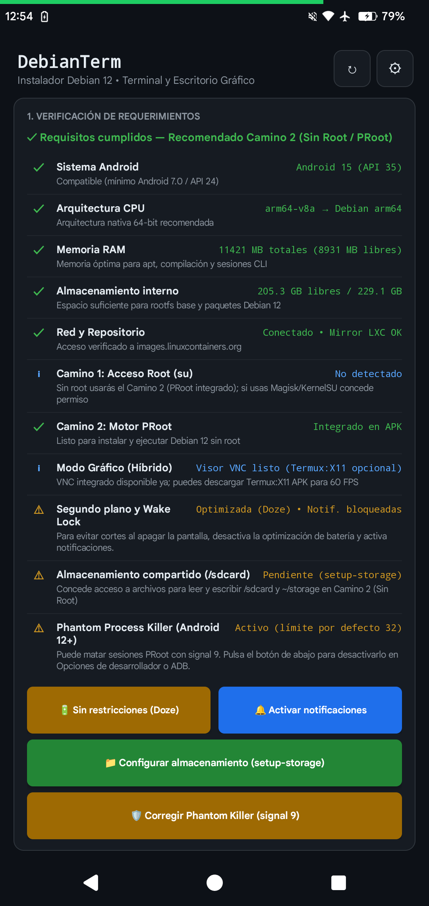
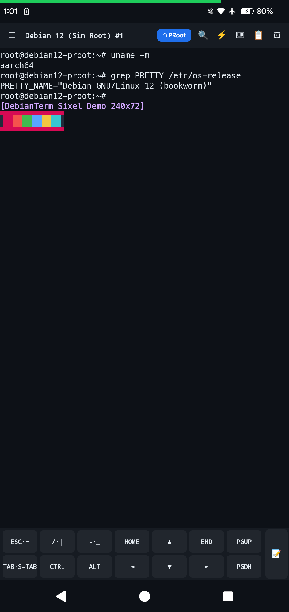
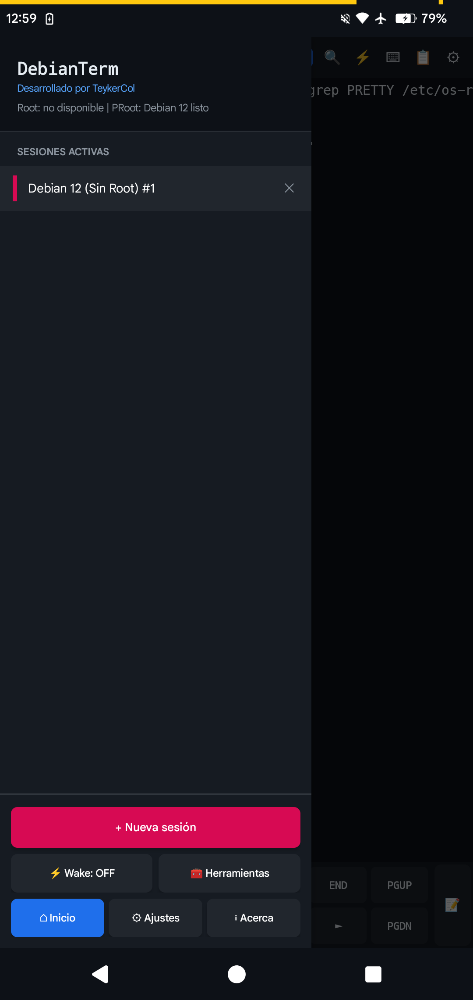
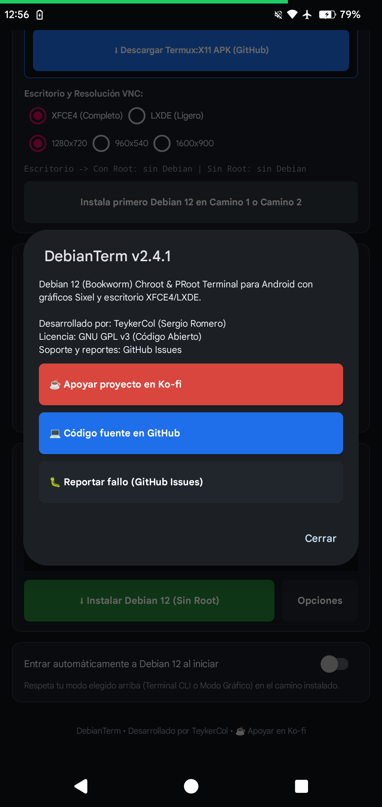
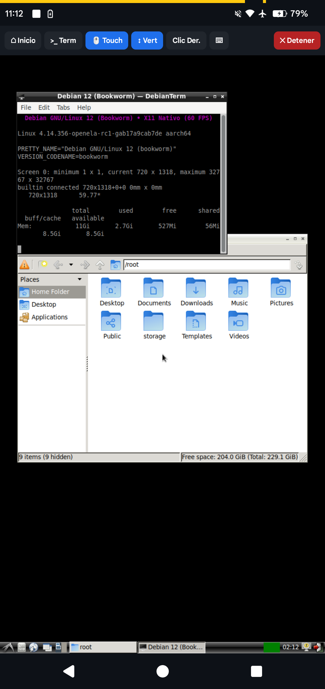

# DebianTerm

<p align="center">
  🇪🇸 <strong>Español</strong> | 🇺🇸 <a href="README.md">English</a>
</p>

<p align="center">
  <a href="https://github.com/thesergio9-spec/DebianTerm/releases/tag/v2.5.3">
    
  </a>
  <a href="LICENSE">
    
  </a>
  
  <a href="https://ko-fi.com/teykercol">
    
  </a>
</p>

**DebianTerm** (`v2.5.3`) es un **instalador completo de Debian 12 (Bookworm)** y emulador de terminal + escritorio gráfico para Android basado en el motor y teclado de Termux (`terminal-emulator` y `terminal-view`), con **verificación de requerimientos mínimos al iniciar**, selector **Terminal (CLI) vs Modo Gráfico Híbrido** y **dos caminos de ejecución totalmente funcionales**:

1. **Camino 1 — Con Root (Chroot Nativo)**: máximo rendimiento del kernel Linux y montajes reales para dispositivos con Magisk, KernelSU o APatch.
2. **Camino 2 — Sin Root (PRoot Integrado)**: motor `PRoot` empaquetado directamente en el APK (`arm64-v8a` y `armeabi-v7a`), **100% independiente de Termux**, para dispositivos sin acceso root.

Coexiste de forma independiente junto a Termux (`com.termux`) usando su propio paquete (`com.debianchroot.term`) y sin modificar instalaciones existentes en `/data/local/debian`.

---

## 📸 Capturas Reales

> Capturadas en un Samsung Galaxy Note 10+ (Android 15) ejecutando DebianTerm `v2.5.0+` y Debian 12 Bookworm.

<table>
  <tr>
    <td align="center"><br><sub><b>Panel de Requisitos y Caminos</b></sub></td>
    <td align="center"><br><sub><b>Terminal Debian 12 y Sixel</b></sub></td>
    <td align="center"><br><sub><b>Menú Lateral Compacto (v2.4.1)</b></sub></td>
    <td align="center"><br><sub><b>Acerca de y Ko-fi</b></sub></td>
    <td align="center"><br><sub><b>Escritorio X11 Nativo (60 FPS • Vertical)</b></sub></td>
  </tr>
</table>

---

## 📥 Descarga Rápida

Descarga el APK compilado desde la última Release:

- **[DebianTerm.apk (v2.5.3)](https://github.com/thesergio9-spec/DebianTerm/releases/download/v2.5.3/DebianTerm.apk)**

---

## 🔒 Transparencia Técnica, `targetSdk=28` y Permisos

DebianTerm es software libre sin publicidad, sin telemetría y con código verificable:

- **¿Por qué `targetSdkVersion=28`?** Android 10–15 bloquea la ejecución directa (`execve`) desde almacenamiento interno de la app en aplicaciones compiladas con `targetSdk >= 29`. Mantener `targetSdk=28` aplica las reglas `untrusted_app_27` para que `libproot.so` y `libproot_loader.so` funcionen sin root ni Termux externo.
- **Almacenamiento compartido (`MANAGE_EXTERNAL_STORAGE`):** solo se solicita cuando el usuario ejecuta explícitamente **`setup-storage`** para acceder a `/sdcard` y `~/storage/*` en modo Sin Root.
- **Autoarranque (`RECEIVE_BOOT_COMPLETED`):** estrictamente opcional (desactivado por defecto) y solo ejecuta los scripts configurados por el usuario cuando se habilita en la configuración.
- **Descargas verificadas:** las imágenes Debian 12 / 13 provienen de `images.linuxcontainers.org` y se validan con `SHA256SUMS` antes de extraerse.

---

## 🚀 Características Principales (`v2.5.3`)

### 1. Panel de Inicio y Verificación de Requerimientos Mínimos
Al abrir la app se ejecuta automáticamente un diagnóstico (`SystemRequirements`) antes de instalar o iniciar Debian 12:
- **Sistema Android**: mínimo Android 7.0 (API 24).
- **Arquitectura CPU**: `arm64-v8a`, `armeabi-v7a` (y soporte `x86_64`/`x86` según binarios).
- **Memoria RAM y Almacenamiento**: verificación de RAM disponible, espacio libre interno y conectividad real contra `images.linuxcontainers.org`.
- **Detección Dual**: detecta root (`Magisk`, `KernelSU`, `APatch`) mediante una única sonda unificada con deduplicación canónica y caché TTL de 60 s (evitando notificaciones repetidas de Magisk al abrir o reanudar la app), motor PRoot integrado, estado Doze, notificaciones (Android 13+), `/sdcard` y **Phantom Process Killer (Android 12+)**.
- **Inicio automático opcional**: interruptor (**"Entrar automáticamente a Debian 12 al iniciar"**) que respeta tu modo elegido (Terminal CLI o Modo Gráfico).

### 2. Modo Gráfico Híbrido antes de iniciar Debian 12 (XFCE4 / LXDE)
- **X11 Nativo Integrado (`libXlorie` 60 FPS — sin apps externas)**: incluye `libXlorie.so` (`arm64-v8a` y `armeabi-v7a`) empaquetado directamente en DebianTerm junto a `LorieView` y `CmdEntryPoint` puros en Java para renderizado acelerado EGL. Soporta orientación **Vertical / Horizontal / Auto por sensor**, botón rápido en vivo (`↕ Vert` / `↔ Horiz` / `⟳ Auto`), modo pantalla completa **`Ajustar`** + presets (`1280x720`, `960x540`, `1600x900`), protección `SOFT_INPUT_ADJUST_PAN` para no girar al abrir teclado en vertical, cursor adaptativo VSYNC/reposo (`0%` CPU al minimizar), `CmdEntryPoint` sin *wakeups* en segundo plano al conectar, barrido `/proc` ultrarrápido y seguro ante `ESRCH` (`grep -aEl` + `dd`) de procesos X11/VNC huérfanos (Root y PRoot), y supresión limpia de `lxpolkit` en LXDE.
- **Visor VNC Integrado (`RfbClient` + `VncCanvasView` + `Xtigervnc`)**: cliente RFB 3.8 puro en Java (`Raw`, `CopyRect`, `Zlib`, `DesktopSize`, redimensión dinámica en vivo mediante `ExtendedDesktopSize` `-308` / `SetDesktopSize` `251` sin reiniciar `Xtigervnc`, portapapeles `ServerCutText`, pausa automática de fotogramas en segundo plano vía `RfbClient.setPaused` al minimizar o volver a CLI/Inicio, y escritura FIFO asíncrona en segundo plano) conectado a `127.0.0.1:5901` con soporte **Vertical** y **`Ajustar`**, modos **Touchpad** y **Táctil directo**, pellizco-zoom, teclado X11 e intercambio rápido `>_ Term`.
- **Instalador de escritorio en 1 toque**: instala **XFCE4 (Completo)** o **LXDE (Ligero)** con `xkb-data`, `dbus-x11` y TigerVNC.

### 3. Dos Caminos de Instalación y Ejecución Debian 12
- **Camino 1 — Con Root (Chroot Nativo)**: detección segura de `/data/local/debian`, script `/data/local/bin/debian` con aislamiento `env -i`, montajes con `timeout 5`, contador `/dev/chroot_sessions` con desmontaje automático al cerrar la última sesión y subcomandos `status`, `stop`/`umount`, `exec`.
- **Camino 2 — Sin Root (PRoot Integrado)**: binarios `libproot.so`, `libproot_loader.so`, `libproot_loader32.so`, extractor Java `TarExtractor` (`USTAR`, `PAX`, `GNU LongName`, symlinks, hardlinks, omisión de `/dev/*`, protección *path traversal*), DNS (`1.1.1.1`, `8.8.8.8`), `aid_inet`, APT sin sandbox, auto-detección `PROOT_NO_SECCOMP` y **`setup-storage`**.

### 4. Menú Lateral Simplificado, Antirebobinado y Productividad
- **Menú Lateral Compacto de 3 Filas:** organiza las acciones en 3 filas inferiores (**`+ Nueva sesión`** -> selector Root / PRoot / Shell Android; **`Wake`** + **`Herramientas`** -> Snippets / `setup-storage` / SAF / Respaldos / Autoarranque; **`Inicio` / `Ajustes` / `Acerca`**), dejando mucho más espacio libre para sesiones activas.
- **Motor Antirebobinado para Conversaciones Largas (`v2.4.2`):** cola PTY de 128 KB con drenaje en ráfaga (512 KB / 12 ms), `DECSET 2026` extendido hasta 1000 ms (guardia de inactividad de 250 ms), coalescencia tras borrados completos `CSI 2 J` / `3 J` (16–64 ms), preservación del scroll al leer arriba durante redibujados `CSI 3 J` e histéresis de altura sin falsos `SIGWINCH` al abrir teclado o barras (`🔍` / `📝`).
- **Salida Segura con `exit` y Wake Lock Persistente:** al ejecutar `exit` en la única sesión interactiva activa cierra Wake/WiFi Lock, detiene `DebianTermService` y cierra la app (`finishAndRemoveTask`); con varias sesiones abiertas solo cierra esa pestaña. Al activar o desactivar Wake Lock manualmente desde el menú lateral o notificación (`Activar Wake` / `Soltar Wake`), su estado persiste entre sesiones y reinicios.
- **Gráficos Sixel inline (`SixelDecoder` / `SixelImage`):** decodificador nativo DEC VT340/XTerm (`img2sixel`, `chafa`, `lsix`, `gnuplot`), reporte DA1 (`;4;`) y `XTSMGRAPHICS` (`256` colores), anclaje al *scrollback* y demo directa en **Ajustes rápidos**.
- **Búsqueda en Terminal (`TerminalSearch`) sobre 10,000 líneas:** historial ampliado a 10,000 filas con sensibilidad `Aa`, `▲`/`▼` y copia rápida.
- **Snippets (`SnippetManager`) y Barra Gboard/Voz (`📝`)**: comandos rápidos y barra de entrada deslizable con autocorrección y dictado.
- **Mitigador de *Phantom Process Killer* (`PhantomProcessManager`)**: detecta `signal 9` en Android 12–15 y ofrece fix directo con Root o comandos ADB exactos sin Root.
- **Storage Access Framework (`DebianDocumentsProvider`)**: acceso a `/root` sin root desde Material Files, Acode, QuickEdit o Archivos sin copiar por `/sdcard`.
- **Respaldo y Restauración `.tar.gz` (`BackupManager`)**: copias de Home + Ajustes, Rootfs PRoot completo o `/root` Chroot.
- **Personalización sin dotfiles**: Nerd Font integrada (`MesloLGS_NF_Regular.ttf`), importación de fuentes `.ttf`/`.otf`, 5 esquemas de color, **Material You** (Android 12+), barra de teclas extra basada en `LinearLayout` con editor visual y presets, Wake Lock + `WifiLock` y autoarranque opcional (`BootReceiver`).

---

## 🛠️ Estructura del Proyecto

```text
DebianTerm/
├── AndroidManifest.xml          # Configuración com.debianchroot.term + SAF Provider (targetSdk 28)
├── assets/fonts/                # Fuente Nerd Font integrada (MesloLGS_NF_Regular.ttf)
├── docs/screenshots/            # Capturas reales en Galaxy Note 10+
├── .github/
│   ├── FUNDING.yml              # Configuración Ko-fi
│   └── ISSUE_TEMPLATE/          # Plantillas de bug y sugerencias
├── LICENSE                      # GNU GPL v3
├── src/
│   ├── com/debianchroot/term/   # UI, Dashboard, Drawer, Chroot/PRoot, SAF, Backups, VNC, X11 y Sixel
│   ├── com/termux/terminal/     # Motor PTY con DECSET 2026, modo Pan y decodificador Sixel
│   ├── com/termux/view/         # Renderizador terminal con Sixel inline y gestos
│   └── com/termux/x11/          # Puente X11 Nativo Lorie (CmdEntryPoint, ICmdEntryInterface, LorieView, MainActivity)
├── libs/                        # Bibliotecas JAR (annotation-1.5.0, xz-1.9)
├── jniLibs/                     # Binarios nativos arm64-v8a y armeabi-v7a (libtermux.so, libXlorie.so, PRoot)
├── tests/                       # Suite de 32 pruebas unitarias en JVM (VerifyAll.java)
├── setup-deps.sh                # Descarga componentes base Termux, JARs, libXlorie.so y PRoot (SHA-256)
└── build.sh                     # Compilación completa (aapt2, javac, d8, zipalign, apksigner)
```

---

## 📦 Compilación desde la Terminal

```bash
git clone https://github.com/thesergio9-spec/DebianTerm.git
cd DebianTerm
./setup-deps.sh
./build.sh
```

El APK firmado se genera en `build/DebianTerm-release.apk`.

---

## 🧪 Pruebas Unitarias

La suite [VerifyAll.java](tests/VerifyAll.java) valida en JVM **32 pruebas clave** (`DECSET 2026`, modo Pan, redibujados sincronizados `>100 KB` y coalescencia de borrado, preservación de scroll `CSI 3 J` / 10,000 líneas, salida segura tras `exit` y sincronización de notificación Wake Lock, parser LXC/SHA-256, scripts `sh -n` y fallback `exec` Root, temas de color, requisitos, `TarExtractor`, PRoot, cierre suave, scripts gráficos XFCE4/LXDE, cliente RFB 3.8, sesiones, `setup-storage`, `PhantomProcessManager`, `TerminalSearch`, `SnippetManager`, `DebianDocumentsProvider`, `BackupManager` `.tar.gz`, Teclas Extra / Nerd Font TTF, `BootReceiver`, `SixelDecoder`, `TerminalEmulator` Sixel, contrato JNI/ELF X11 nativo integrado, orientación/resolución `Ajustar`, limpieza de procesos X11/VNC huérfanos + redimensión RFB en vivo, optimizaciones de energía/CPU con barrido `/proc` seguro ante `ESRCH`, pausa/reanudación RFB, cursor X11 adaptativo y `WifiLock` eficiente, y sonda `su` unificada de 1 sola llamada con deduplicación canónica y caché TTL):

```bash
javac -encoding UTF-8 -cp build/classes:/opt/android-sdk/android.jar:libs/xz-1.9.jar -d build/test-classes tests/VerifyAll.java
java -cp build/test-classes:build/classes:/opt/android-sdk/android.jar:libs/xz-1.9.jar VerifyAll
```

---

## 👤 Autor, Soporte y Licencia

- **Desarrollador:** Sergio Romero (**TeykerCol**) — [@thesergio9-spec](https://github.com/thesergio9-spec)
- **Reportes de fallos y sugerencias:** Exclusivamente mediante **[GitHub Issues](https://github.com/thesergio9-spec/DebianTerm/issues)**.
- **Apoyar el proyecto:** Si DebianTerm te resulta útil, puedes invitar un café en **[Ko-fi](https://ko-fi.com/teykercol)**.
- **Licencia:** Distribuido bajo **GNU General Public License v3.0** ([LICENSE](LICENSE)), reutilizando componentes de código abierto de [Termux](https://github.com/termux/termux-app) (GPLv3), [Termux:X11](https://github.com/termux/termux-x11) (GPLv3) y [PRoot](https://github.com/termux/proot) (GPLv2+ / GPLv3).
