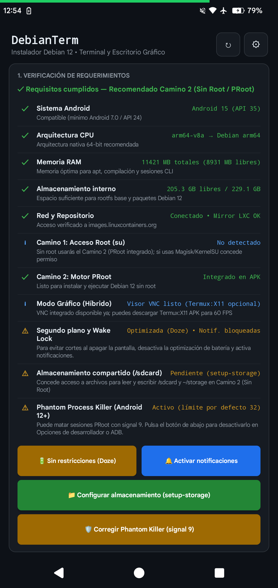
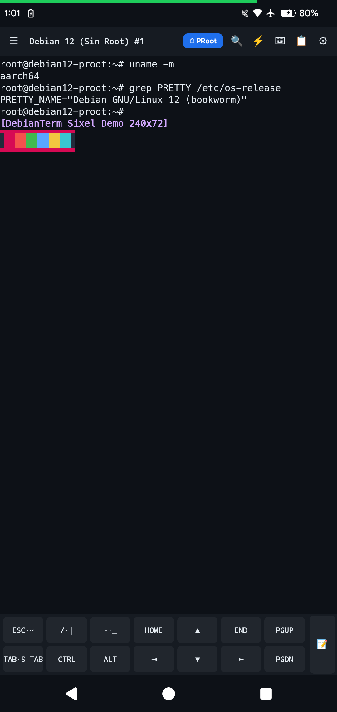
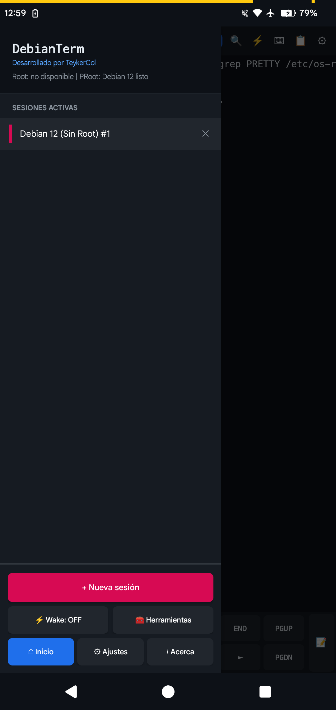
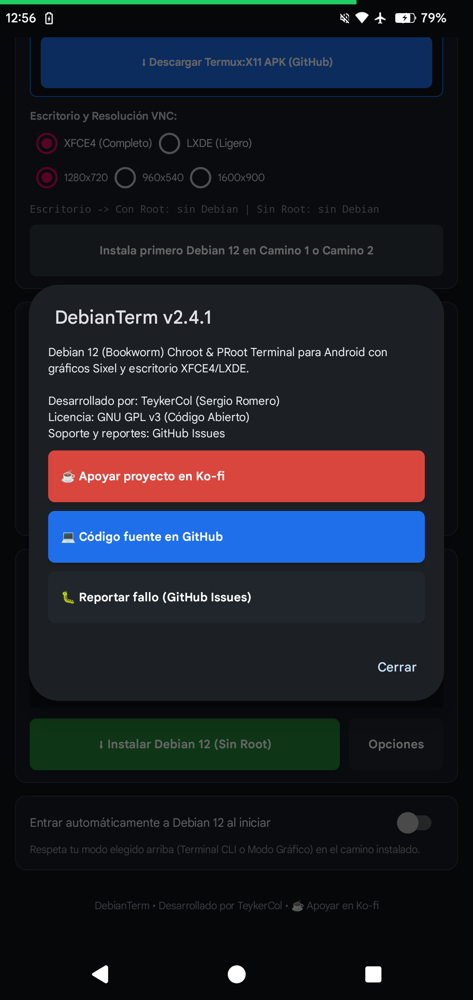
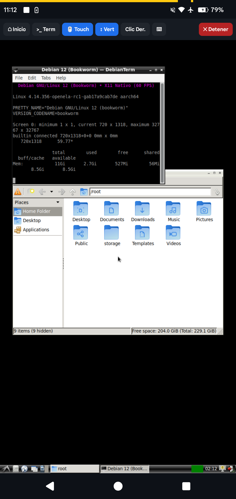

# DebianTerm

<p align="center">
  🇺🇸 <strong>English</strong> | 🇪🇸 <a href="README.es.md">Español</a>
</p>

<p align="center">
  <a href="https://github.com/thesergio9-spec/DebianTerm/releases/tag/v2.5.2">
    
  </a>
  <a href="LICENSE">
    
  </a>
  
  <a href="https://ko-fi.com/teykercol">
    
  </a>
</p>

**DebianTerm** (`v2.5.2`) is a complete **Debian 12 (Bookworm) installer, terminal emulator, and hybrid graphical desktop** for Android built around Termux's terminal engine (`terminal-emulator` and `terminal-view`). It launches with an **automatic device requirements check**, a **Terminal (CLI) vs. Graphical Desktop** selector, and **two independent execution paths**:

1. **Path 1 — Rooted (Native Chroot):** native Linux kernel performance and real mounts for Magisk, KernelSU, or APatch devices.
2. **Path 2 — Rootless (Bundled PRoot):** embedded `PRoot` binaries (`arm64-v8a` and `armeabi-v7a`) packaged directly inside the APK — **100% standalone, no Termux app required**.

DebianTerm runs under its own application ID (`com.debianchroot.term`), safely coexists alongside Termux (`com.termux`), and never modifies pre-existing `/data/local/debian` setups without explicit action.

---

## 📸 Screenshots

> Captured on a Samsung Galaxy Note 10+ (Android 15) running DebianTerm `v2.5.0+` and Debian 12 Bookworm.

<table>
  <tr>
    <td align="center"><br><sub><b>Requirements & Dual Path Dashboard</b></sub></td>
    <td align="center"><br><sub><b>Debian 12 CLI & Inline Sixel</b></sub></td>
    <td align="center"><br><sub><b>Simplified 3-Row Drawer (v2.4.1)</b></sub></td>
    <td align="center"><br><sub><b>About & Ko-fi Support</b></sub></td>
    <td align="center"><br><sub><b>Native X11 Desktop (60 FPS • Vertical)</b></sub></td>
  </tr>
</table>

---

## 📥 Download

Grab the latest signed release APK directly from GitHub Releases:

- **[DebianTerm.apk (v2.5.2)](https://github.com/thesergio9-spec/DebianTerm/releases/download/v2.5.2/DebianTerm.apk)**

---

## 🔒 Security, `targetSdk=28` & Permissions Transparency

DebianTerm is open source, ad-free, and contains zero analytics or telemetry:

- **Why `targetSdkVersion=28`?** Android 10–15 restricts `execve` from writable app data directories on apps targeting API 29+ (`W^X` / SELinux `untrusted_app` domain). Targeting API 28 keeps Android's `untrusted_app_27` execution rules active so bundled `libproot.so` and `libproot_loader.so` run directly without requiring Termux or root.
- **Storage access (`MANAGE_EXTERNAL_STORAGE`):** only requested when the user explicitly triggers **`setup-storage`** to bridge `/sdcard` and `~/storage/*` into PRoot.
- **Boot execution (`RECEIVE_BOOT_COMPLETED`):** strictly opt-in (disabled by default) and runs only user-configured boot scripts when enabled in Boot Autostart settings.
- **Verified downloads:** Debian 12 / 13 rootfs tarballs are fetched directly from `images.linuxcontainers.org` and verified against `SHA256SUMS` before extraction.

---

## 🚀 Key Features (`v2.5.2`)

### 1. Startup Requirements & Mode Selector Dashboard
On startup, `SystemRequirements` evaluates device readiness before installing or launching Debian:
- **Android & CPU:** Android 7.0+ (`API 24+`), `arm64-v8a` / `armeabi-v7a` binary checks.
- **RAM, Storage & Mirror Check:** verifies free memory, storage headroom, and live HTTPS connectivity to `images.linuxcontainers.org`.
- **Dual Mode Detection:** probes Magisk / KernelSU / APatch (`su`), bundled PRoot binaries, Doze exemption status, Notification permissions (Android 13+), Shared Storage readiness, and **Android 12+ Phantom Process Killer**.
- **Auto-Enter Switch:** optional toggle (**"Entrar automáticamente a Debian 12 al iniciar"**) that respects your chosen CLI or Graphical startup mode.

### 2. Hybrid Graphical Desktop (XFCE4 / LXDE)
Choose **Terminal (CLI)** or **Graphical Mode** before launching Debian:
- **Built-in Native X11 (`libXlorie` 60 FPS — zero external apps required):** bundles `libXlorie.so` (`arm64-v8a` / `armeabi-v7a`) directly inside DebianTerm with pure-Java `LorieView` & `CmdEntryPoint` for hardware-accelerated EGL rendering. Includes sensor-driven **`Auto`** / **Vertical** / **Horizontal** screen orientation controls, a live toolbar toggle (`↕ Vert` / `↔ Horiz` / `⟳ Auto`), full-screen **`Ajustar`** (fit-to-screen) scaling plus fixed presets (`1280x720`, `960x540`, `1600x900`), `SOFT_INPUT_ADJUST_PAN` portrait keyboard protection, adaptive VSYNC/idle cursor scheduling (`0%` CPU when minimized/stopped), zero-wakeup `CmdEntryPoint` once connected, fast `ESRCH`-safe `/proc` orphan process cleanup (`grep -aEl` + bounded `dd`) across Root & PRoot, and clean `lxpolkit` suppression for LXDE.
- **Built-in VNC Viewer Fallback (`RfbClient` + `VncCanvasView` + `Xtigervnc`):** pure-Java RFB 3.8 client (`Raw`, `CopyRect`, continuous `Zlib`, `DesktopSize`, `ExtendedDesktopSize` `-308` / `SetDesktopSize` `251` live dynamic orientation resizing without restarting `Xtigervnc`, `ServerCutText` clipboard sync, automatic background `FramebufferUpdateRequest` suspension via `RfbClient.setPaused` when minimized or switching to CLI/Dashboard, and async FIFO socket writer) connecting locally to `127.0.0.1:5901` with portrait & **`Ajustar`** geometry support, Trackpad & Direct Touch modes, pinch-to-zoom, on-screen X11 keyboard, and 1-tap `>_ Term` switching.
- **1-Tap Desktop Installer:** installs **XFCE4 (Full)** or **LXDE (Lightweight)** with `xkb-data`, `dbus-x11`, and TigerVNC.

### 3. Two Complete Execution Paths
- **Path 1 — Rooted Native Chroot:** detects existing `/data/local/debian` (or custom path) safely; generates an isolated `/data/local/bin/debian` entry script (`env -i`, `timeout 5 mount`, `/dev/chroot_sessions` reference counting with automatic unmount when the last tab closes); supports `status`, `stop`/`umount`, `exec`.
- **Path 2 — Rootless Bundled PRoot:** bundles `libproot.so`, `libproot_loader.so`, and `libproot_loader32.so`; pure-Java `TarExtractor` (`USTAR`, `PAX`, `GNU LongName`, safe symlink/hardlink handling, `/dev/*` skip, path-traversal protection); preconfigures DNS (`1.1.1.1`, `8.8.8.8`), `aid_inet`, APT sandbox rules, auto-`PROOT_NO_SECCOMP` fallback, `/proc/*` bindings, and `setup-storage`.

### 4. Simplified Drawer, Anti-Rewind Engine & Productivity
- **Simplified 3-Row Navigation Drawer:** collapses actions into 3 compact bottom rows (**`+ Nueva sesión`** chooser -> Root / PRoot / Android shell; **`Wake`** + **`Herramientas`** -> Snippets / `setup-storage` / SAF / Backups / Boot Autostart; **`Inicio` / `Ajustes` / `Acerca`**) so active terminal sessions get clean vertical breathing room.
- **Long-Conversation Anti-Rewind Engine (`v2.4.2`):** 128 KB PTY queue with 512 KB/12 ms burst drain, `DECSET 2026` synchronized redraws held up to 1000 ms (250 ms idle guard), 16–64 ms destructive-erase settle coalescing (`CSI 2 J` / `3 J`), scrolled-up distance preservation across `CSI 3 J` TUI redraws, and hysteresis against transient IME/toolbar (`🔍` / `📝`) `SIGWINCH` resizes.
- **Safe Full-App Exit & Persistent Wake Lock Controls:** running `exit` closes only that tab when multiple sessions are open, or safely releases Wake/WifiLock, stops `DebianTermService`, and removes the task when exiting the last interactive shell; manual Wake Lock toggles from the in-app drawer or notification shade (`Activar Wake` / `Soltar Wake`) persist across sessions/restarts and stay synced in real time.
- **Inline Sixel Graphics (`SixelDecoder` / `SixelImage`):** native DEC VT340/XTerm Sixel rendering (`img2sixel`, `chafa`, `lsix`, `gnuplot`) with DA1 (`;4;`) & `XTSMGRAPHICS` reporting (`256` color registers), scrollback anchoring, and a built-in demo trigger in Quick Settings.
- **10,000-Line Scrollback Search (`TerminalSearch`):** expanded 10,000-row transcript buffer with case-sensitive toggle, `▲`/`▼` navigation, scrollback-anchored highlights, and quick line copy.
- **Snippets (`SnippetManager`) & Gboard/Voice Input Dock:** quick-command drawer plus a swipeable bottom text bar for autocorrect, swipe typing, and voice dictation.
- **Phantom Process Killer (`PhantomProcessManager`):** detects Android 12–15 `signal 9` risk and provides 1-tap root fix or exact ADB mitigation commands.
- **Storage Access Framework (`DebianDocumentsProvider`):** browse and edit rootless `/root` directly from Android file managers and editors (Material Files, Acode, QuickEdit) with path-traversal and external-symlink guards.
- **1-Tap `.tar.gz` Backup & Restore (`BackupManager`):** pure-Java USTAR/PAX archive & restore for Home/Settings, full PRoot rootfs, or Root chroot `/root`.
- **No-Dotfiles Customization:** bundled **MesloLGS Nerd Font** (`MesloLGS_NF_Regular.ttf`), custom `.ttf`/`.otf` font importer, 5 color schemes, Android 12+ Material You dynamic accents, rock-solid `LinearLayout`-based 2-row Extra Keys bar with visual editor & presets, Wake Lock + `WifiLock`, and opt-in **`BootReceiver` (`BOOT_COMPLETED`)** automation.

---

## 🛠️ Project Structure

```text
DebianTerm/
├── AndroidManifest.xml              # com.debianchroot.term + SAF Provider + BootReceiver (targetSdk 28)
├── assets/fonts/                    # Bundled MesloLGS Nerd Font (MesloLGS_NF_Regular.ttf)
├── docs/screenshots/                # Real Galaxy Note 10+ UI screenshots
├── .github/
│   ├── FUNDING.yml                  # Ko-fi funding configuration
│   └── ISSUE_TEMPLATE/              # Bug report & feature request templates
├── LICENSE                          # GNU General Public License v3
├── src/
│   ├── com/debianchroot/term/
│   │   ├── MainActivity.java            # Dashboard, Terminal, Simplified Drawer, Desktop & Orientation UI
│   │   ├── DebianDocumentsProvider.java # SAF DocumentProvider for rootless /root access
│   │   ├── BackupManager.java           # Pure-Java .tar.gz backup & restore
│   │   ├── BootReceiver.java            # Opt-in BOOT_COMPLETED automation
│   │   ├── SystemRequirements.java      # Hardware, storage, LXC & Phantom Killer checks
│   │   ├── DesktopManager.java          # XFCE4/LXDE, Built-in Native X11 & Xtigervnc manager
│   │   ├── RfbClient.java               # Pure-Java RFB 3.8 VNC client
│   │   ├── VncCanvasView.java           # Interactive VNC canvas + pinch-zoom + X11 keys
│   │   ├── ChrootManager.java           # Root detection & /data/local/bin/debian management
│   │   ├── ProotManager.java            # Rootless Debian 12 lifecycle & storage bindings
│   │   ├── ChrootInstaller.java         # LXC image resolver & SHA-256 verification
│   │   ├── TarExtractor.java            # Pure-Java .tar.xz extractor
│   │   ├── DebianTermService.java       # Foreground service, session lifecycle & Wake/WifiLock
│   │   ├── PhantomProcessManager.java   # Android 12+ Phantom Process Killer mitigation
│   │   ├── TerminalSearch.java          # Scrollback search engine
│   │   ├── SnippetManager.java          # Command snippets serializer & manager
│   │   ├── TerminalSettings.java        # Preferences, color schemes, orientation & presets
│   │   ├── ExtraKeysBarView.java        # 2-row Extra Keys bar + swipe dock
│   │   └── SlideDrawerLayout.java       # Navigation drawer container
│   ├── com/termux/terminal/         # Termux PTY engine, DECSET 2026, Pan mode & SixelDecoder
│   ├── com/termux/view/             # Terminal renderer with inline Sixel support
│   └── com/termux/x11/              # Built-in Lorie X11 bridge (CmdEntryPoint, ICmdEntryInterface, LorieView, MainActivity)
├── libs/                            # JAR dependencies (annotation-1.5.0, xz-1.9)
├── jniLibs/                         # arm64-v8a & armeabi-v7a (libtermux.so, libXlorie.so, PRoot binaries)
├── tests/                           # 31 pure-JVM verification tests (VerifyAll.java)
├── setup-deps.sh                    # Fetches Termux engine, JARs, libXlorie.so & SHA-256 verified PRoot binaries
└── build.sh                         # Compiles, links, aligns & signs APK (aapt2, d8, apksigner)
```

---

## 📦 Build from Source

```bash
# 1. Clone the repository
git clone https://github.com/thesergio9-spec/DebianTerm.git
cd DebianTerm

# 2. Download Termux sources, JAR dependencies, and SHA-256 verified PRoot binaries
./setup-deps.sh

# 3. Compile, align, and sign the release APK
./build.sh
```

The signed APK is output at `build/DebianTerm-release.apk`.

---

## 🧪 Unit Tests

[tests/VerifyAll.java](tests/VerifyAll.java) runs **31 standalone JVM tests** covering `DECSET 2026`, anti-rewind Pan mode, large >100 KB sync redraw & erase-settle coalescing, `CSI 3 J` scrollback preservation (10,000-row transcript), safe last-shell app exit & Wake Lock notification sync, live LXC image parsing, root script `sh -n` validation & root `exec` fallback, color schemes, system requirements checks, `TarExtractor` PAX/symlinks/traversal safety, PRoot launcher validation, graceful shutdown, desktop scripts, simulated RFB 3.8 VNC server round-trips, session numbering reuse, `setup-storage`, `PhantomProcessManager`, `TerminalSearch`, `SnippetManager`, `DebianDocumentsProvider` path safety, `BackupManager` `.tar.gz` round-trips, `ExtraKeysBarView`/Nerd Font TTF validation, `BootReceiver`, `SixelDecoder`, `TerminalEmulator` Sixel rendering, built-in native X11 JNI contract & ELF binaries, desktop orientation/fit-to-screen resolution (`X11` & `VNC`), orphan X11/VNC sweeper + live RFB `ExtendedDesktopSize` resizing, and power/CPU optimizations (ESRCH-safe `/proc` sweeper, RFB background pause/resume, adaptive X11 cursor & power-efficient `WifiLock`):

```bash
javac -encoding UTF-8 -cp build/classes:/opt/android-sdk/android.jar:libs/xz-1.9.jar -d build/test-classes tests/VerifyAll.java
java -cp build/test-classes:build/classes:/opt/android-sdk/android.jar:libs/xz-1.9.jar VerifyAll
```

---

## 👤 Author, Support & License

- **Developer:** Sergio Romero (**TeykerCol**) — [@thesergio9-spec](https://github.com/thesergio9-spec)
- **Bug Reports & Feature Requests:** Please open an issue on **[GitHub Issues](https://github.com/thesergio9-spec/DebianTerm/issues)**.
- **Support the Project:** If DebianTerm is useful on your workflow or device, consider buying a coffee on **[Ko-fi](https://ko-fi.com/teykercol)**.
- **License:** Distributed under the **GNU General Public License v3.0** — see [LICENSE](LICENSE). Built using open-source components from [Termux](https://github.com/termux/termux-app) (GPLv3), [Termux:X11](https://github.com/termux/termux-x11) (GPLv3), and [PRoot](https://github.com/termux/proot) (GPLv2+ / GPLv3).
